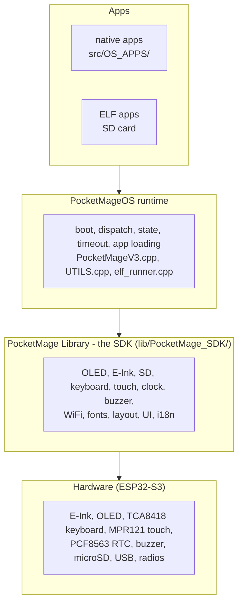
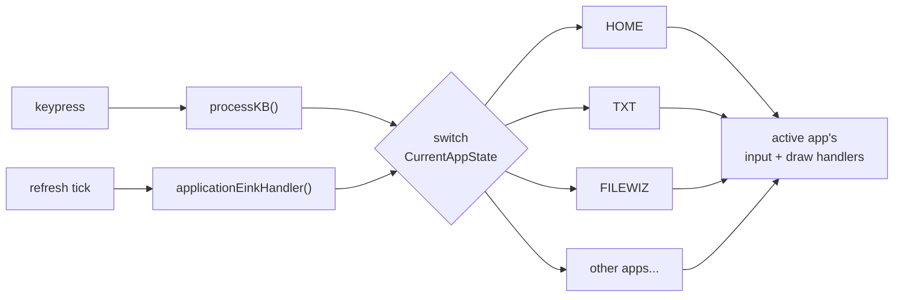
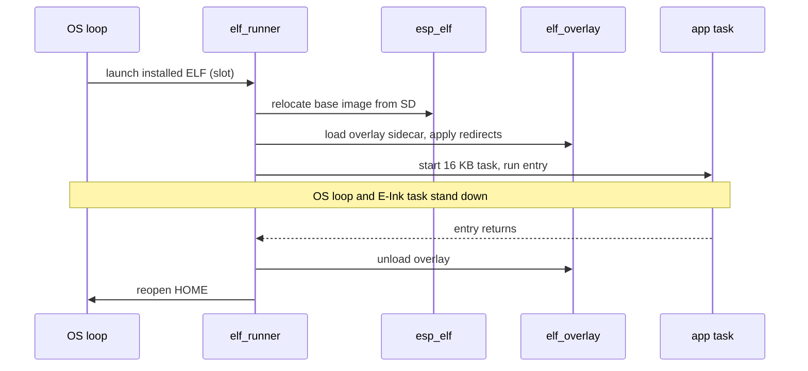

# Architecture

PocketMageOS is a single-core-visible cooperative state machine on an ESP32-S3. One variable, `CurrentAppState`, decides which app owns the keyboard and the screens; the main loop routes every keystroke and every screen refresh to that app's handlers. This page is the map of the whole system and where each part is documented in depth.

## The layers

Apps never touch hardware directly. They call the library; the library is the only layer that knows the pins. That boundary is what lets the same app code build as a native app, as a loadable ELF, and against future hardware revisions.

## Boot

On power-up the OS mounts the SD card, initializes the displays and keyboard, and loads persistent settings from NVS. It then decides which app to enter based on how the device woke:

- Normal boot enters HOME, unless `HOME_ON_BOOT` is off.
- A wake with a held shortcut key enters the mapped app (for example `n` opens TXT). The mapping is `bootShortcutApp()` in `UTILS.cpp`.
- A wake from now-later returns to the app that was active before sleep, with its saved state restored.

## Dispatch

The main loop in `PocketMageV3.cpp` is a cooperative dispatcher. Two functions switch on `CurrentAppState`:

- `processKB()` routes each keypress to the active app's keyboard handler.
- `applicationEinkHandler()` routes each screen refresh to the active app's draw handler.

Every app is three functions - init, handle input, draw - and the app never drives the loop itself.

The full state model, the `AppState` enum, the HOME sub-states, and the transition helpers are in the [System State reference](../reference/system-state.md).

## The two displays

The device pairs a slow, sharp 320x240 E-Ink panel with a fast 256x32 OLED. Anything that benefits from instant feedback - prompts, status, timers - goes to the OLED; anything that benefits from a large readable page - notes, files, calendars - goes to the E-Ink. The E-Ink panel is guarded by a recursive mutex and refreshed from a background task, so code in other tasks must respect that boundary. The display APIs are in the [PocketMage Library reference](../reference/pocketmage-library.md), with the full per-module contract on the [SDK API docs](https://talismandesign.github.io/PocketMage_SDK/docs/api/).

## State and timeout

The OS keeps shared runtime state in `globals.h`: the active app, the home sub-state, the re-init flag, persistent preferences, the active filesystem handle, and the idle-timeout lockout. After `IDLE_TIME` without input the OS shows the idle state; after `TIMEOUT` it sleeps. Apps reset the idle clock with `resetIdle()` or hold it off with `disableTimeout`. The full list is in the [System State reference](../reference/system-state.md#system-state-reference-shared-state-you-will-touch).

## Storage

Files live on a microSD card, reached through the library's SD module (`PM_SD()`). The OS tracks a working file and an editing file for save/load flows, and installed ELF apps live in four slots under `/apps/slot1` through `/apps/slot4`, tracked in NVS as `ELFINFO1` through `ELFINFO4`.

## How apps run

Native and ELF apps share the three-function shape; they differ only in where the code ships and how it is loaded.

- **Native apps** are compiled into the firmware under `src/OS_APPS/` and wired into the dispatch switch. See [Native Apps](../guides/native-apps.md).
- **ELF apps** are built separately against the SDK, packed with an overlay sidecar, and loaded from the SD card at runtime by `src/elf_runner.cpp`. The runner relocates the base image with `esp_elf`, pages the app's code into executable RAM through the `elf_overlay` runtime, and runs the entry in its own 16 KB task while the OS loop and the E-Ink task stand down. Returning from the entry unloads the app and reopens HOME. See [ELF Apps](../guides/elf-apps.md), and the SDK's [App ABI](https://talismandesign.github.io/PocketMage_SDK/docs/app-abi/) and [Overlay format](https://talismandesign.github.io/PocketMage_SDK/docs/overlay/).

## Source map

| Path                                        | Role                                          |
| ------------------------------------------- | --------------------------------------------- |
| `src/PocketMageV3.cpp`                       | main loop and app dispatch                    |
| `src/OS_APPS/`                               | native app code, one file per app             |
| `src/UTILS.cpp`                              | shared prompts, boot shortcuts, runtime helpers |
| `src/elf_runner.cpp`                         | loads and runs installed ELF apps             |
| `src/ELF_SYMS/`                              | the generated host export table for ELF apps  |
| `include/globals.h`                          | app prototypes, app state, shared runtime state |
| `include/config.h`                           | pins and system settings                      |
| `lib/PocketMage_SDK/`                        | the reusable hardware layer (the SDK)         |
| `lib/elf_overlay/`                           | the overlay runtime for ELF-app code          |

## Read next

- [System State reference](../reference/system-state.md)
- [PocketMage Library reference](../reference/pocketmage-library.md)
- [ELF Apps](../guides/elf-apps.md)
- [Build Environments](build-environments.md)
